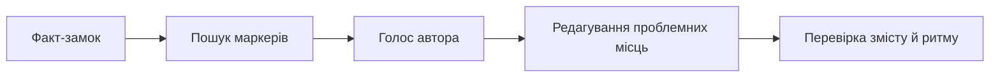

# 🇺🇦 humanizer-ua

> Українська навичка для Codex і Claude, яка повертає текстові природний ритм,
> ясність і голос автора. Факти залишаються на місці.

[](https://github.com/Vicarta/humanizer-ua/releases/latest)
[](https://github.com/Vicarta/humanizer-ua/actions/workflows/ci.yml)
[](LICENSE)
[](https://github.com/Vicarta/humanizer-ua/releases/latest/download/humanizer-ua.zip)

Текст може бути правильним за всіма правилами й усе одно не мати голосу.
Речення однакової довжини, вступ ні про що, канцелярські іменники замість дій,
кальки, які наче переклали двічі. `humanizer-ua` знаходить такі місця й
допомагає переписати їх природною українською.

Навичка працює з готовим текстом. Вона не вигадує досвід автора, не підміняє
числа або цитати й не додає помилок «для людяності».

## Навіщо українській окрема адаптація

Універсальні англомовні правила пропускають типові українські збої. Механічний
переклад російського каталогу теж не спрацює: частина проблем збігається, але
українська має власне керування, милозвучність і набір поширених кальок.

| Шаблонна або калькована фраза | Природніший напрям |
|---|---|
| «здійснювати проведення аналізу» | «аналізувати» |
| «приймати участь» | «брати участь» |
| «на протязі місяця» | «протягом місяця» |
| «даний підхід являється ефективним» | «цей підхід ефективний» |
| «відіграє важливу роль» | назвати конкретний вплив |
| «дозволяє ефективно здійснювати» | поставити дію в центр речення |

Каталог `humanizer-ua` охоплює 42 патерни в 11 категоріях: від порожніх
вступів і канцеляриту до артефактів чатбота, шаблонного ритму та надто гладкої
причинності. Окремо сканер перевіряє 20 сильних маркерів.

## До і після

**До**

> У сучасному світі онлайн-сервіси відіграють важливу роль у роботі команд.
> Варто зазначити, що цей інструмент дозволяє ефективно здійснювати перевірку
> текстів і сприяє підвищенню їхньої якості.

Сканер знаходить п'ять сильних маркерів, канцелярську конструкцію й дає
редакторську оцінку `52/100`.

**Після**

> Команди використовують цей онлайн-сервіс, щоб перевіряти тексти й
> поліпшувати їхню якість.

Оцінка після редагування: `100/100`. Жодного нового факту в тексті не
з'явилося.

## Як працює humanizer-ua



1. **Фіксує зміст.** Імена, числа, дати, цитати, умови й модальність не можна
   змінювати без джерела.
2. **Шукає проблемні місця.** Навичка відділяє природні абзаци від тих, де
   потрібна точкова правка або повний рерайт.
3. **Вловлює голос.** Якщо є авторські зразки, враховує їхній ритм, лексику,
   пунктуацію та дистанцію до читача.
4. **Редагує вибірково.** Точні терміни, цитати й вдалі речення залишаються.
5. **Перевіряє результат.** Окремо проходить зміст, читабельність, ритм і
   факт-замок.

## Три режими

| Режим | Коли потрібен | Що повертає |
|---|---|---|
| Повне редагування | текст звучить безособово або шаблонно | готовий текст і коротке пояснення змін |
| Аудит | треба знайти проблеми, не торкаючись оригіналу | оцінку, маркери та пріоритети правок |
| Точкова правка | треба прибрати лише канцелярит, кальки, ритм або іншу категорію | текст зі змінами тільки в заданих межах |

Спробуйте один із запитів:

```text
Перепиши природною українською, але не змінюй факти: ...
Перевір цей текст на AI-маркери й нічого не редагуй: ...
Прибери лише канцелярит: ...
Ось два мої тексти. Збережи їхній голос під час редагування нового: ...
```

## Встановлення

### Codex

Скопіюйте цей запит у Codex:

```text
Встанови скіл humanizer-ua з https://github.com/Vicarta/humanizer-ua/tree/main/skills/humanizer-ua
```

Codex використає системний `$skill-installer`. Навичка буде доступна в
наступному запиті; якщо вона не з'явилася, перезапустіть Codex.
[Документація Codex про встановлення skills](https://developers.openai.com/codex/skills/#install-curated-skills-for-local-use).

<details>
<summary><strong>Встановити в Codex вручну</strong></summary>

```bash
git clone https://github.com/Vicarta/humanizer-ua.git
mkdir -p ~/.codex/skills
cp -R humanizer-ua/skills/humanizer-ua ~/.codex/skills/
```

Для одного проєкту скопіюйте папку навички в
`.codex/skills/humanizer-ua`. Явний виклик: `$humanizer-ua`.

</details>

### Claude.ai

1. Завантажте готовий
   [humanizer-ua.zip](https://github.com/Vicarta/humanizer-ua/releases/latest/download/humanizer-ua.zip).
2. Відкрийте **Settings → Capabilities → Skills**.
3. Натисніть **Upload skill** і виберіть ZIP.

Розпаковувати архів або встановлювати Python не потрібно.

### Claude Code через marketplace

```text
/plugin marketplace add Vicarta/humanizer-ua
/plugin install humanizer-ua@vicarta-plugins
```

Після встановлення доступні команди `/humanize` та `/audit`.

### Claude Code вручну

```bash
git clone https://github.com/Vicarta/humanizer-ua.git
mkdir -p ~/.claude/skills
cp -R humanizer-ua/skills/humanizer-ua ~/.claude/skills/
```

## Що показує сканер

Локальний сканер не потребує сторонніх Python-пакетів. Він знаходить сильні й
м'які мовні маркери, оцінює ритм речень, структуру абзаців, повтори у списках,
номіналізації та щільність тире.

```bash
python3 skills/humanizer-ua/scripts/scan.py article.txt
python3 skills/humanizer-ua/scripts/scan.py article.txt --genre academic
python3 skills/humanizer-ua/scripts/scan.py article.txt --json
```

Підтримувані жанри: `marketing`, `neutral`, `academic`, `legal`, `fiction`.
Жанровий фільтр прибирає спрацювання, які можуть бути нормою для академічного,
юридичного або художнього тексту.

Скорочений звіт для прикладу «До»:

```text
РЕДАКТОРСЬКА ЧИСТОТА: 52/100 [потрібен рерайт]

⛔ У сучасному світі
⛔ Варто зазначити
⛔ Відіграє важливу роль
⛔ Дозволяє ефективно
⛔ Сприяє підвищенню
• канцелярит: «здійснювати перевірку»
```

Оцінка показує щільність редакторських сигналів. Це не визначення авторства й
не ймовірність того, що текст створила модель.

## Порівняння

| | `humanizer-ua` | [`humanizer-ru`](https://github.com/ilyautov/humanizer-ru) | Універсальні англомовні правила |
|---|---|---|---|
| Основна мова | українська | російська | англійська |
| Українські кальки й русизми | так | ні | ні |
| Милозвучність і українське керування | так | ні | ні |
| Каталог | 42 патерни | 64 патерни | залежить від реалізації |
| Сильні маркери | 20 | 20 | залежить від реалізації |
| Локальний сканер | без зовнішніх залежностей | російський морфологічний стек | залежить від реалізації |
| Перевірене пакування | Codex і Claude | кілька агентських платформ | залежить від проєкту |

`humanizer-ua` не є дослівним перекладом російської версії. Український
каталог, правила редагування, сканер і тести створено окремо.

## Часті питання

<details>
<summary><strong>Чи визначає сканер, що текст написав AI?</strong></summary>

Ні. Він знаходить редакторські сигнали: кліше, кальки, рівний ритм і шаблонну
структуру. Такі ознаки трапляються і в людських текстах, тому оцінка не є
вердиктом про авторство.

</details>

<details>
<summary><strong>Чи гарантує навичка проходження GPTZero або іншого детектора?</strong></summary>

Ні. `humanizer-ua` поліпшує текст за мовними й редакторськими критеріями, а не
підганяє його під конкретний детектор.

</details>

<details>
<summary><strong>Чи може редагування змінити факти?</strong></summary>

Факт-замок прямо забороняє додавати або підміняти імена, числа, дати, цитати,
джерела, умови та висновки. Після переписування навичка перевіряє їх окремим
проходом.

</details>

<details>
<summary><strong>Чи потрібен Python?</strong></summary>

Для роботи навички в Codex або Claude — ні. Python потрібен лише для запуску
детермінованого сканера та локальних тестів. Сканер використовує стандартну
бібліотеку й не тягне додаткових пакетів.

</details>

<details>
<summary><strong>Чи можна залишити професійні терміни, англіцизми й авторську пунктуацію?</strong></summary>

Так. Точний термін кращий за вимучену «питомість». Довге тире теж не
заборонене: сканер реагує лише на його надмірну щільність, а редактор враховує
жанр і голос автора.

</details>

<details>
<summary><strong>Чи підходить навичка для юридичних і академічних текстів?</strong></summary>

Так, але з нижчою інтенсивністю правок. Для юридичного тексту формулювання з
правовими наслідками захищені, а сканер має окремі жанри `legal` та `academic`.

</details>

<details>
<summary><strong>Чи можна користуватися без плагіна?</strong></summary>

Так. Достатньо скопіювати всю папку `skills/humanizer-ua` в каталог навичок
Codex або Claude. Важливо копіювати папку цілком, бо разом із `SKILL.md` у ній
лежать каталог патернів і сканер.

</details>

<details>
<summary><strong>Що відбувається з моїм текстом?</strong></summary>

Сканер працює локально, не має телеметрії та нічого не надсилає в мережу.
Обробка самим Codex або Claude підпорядковується політиці сервісу, у якому ви
запустили навичку.

</details>

## Для розробників

```bash
python3 scripts/lint_skill.py
python3 -m unittest discover -s tests -v
python3 scripts/build_release_zip.py
python3 scripts/install_smoke.py --zip dist/humanizer-ua.zip
```

CI перевіряє frontmatter навички, нумерацію каталогу, маніфести JSON,
регресійні тести сканера, релізний ZIP та встановлення з чистої копії.

Історія змін: [CHANGELOG.md](CHANGELOG.md).

## Походження

Проєкт створено на основі
[`ilyautov/humanizer-ru`](https://github.com/ilyautov/humanizer-ru) за ліцензією
MIT. Автор оригіналу — Ilya Utov. Українську адаптацію підтримує Vicarta.

Ліцензію див. у [LICENSE](LICENSE), атрибуцію та опис відмінностей — у
[NOTICE.md](NOTICE.md).
